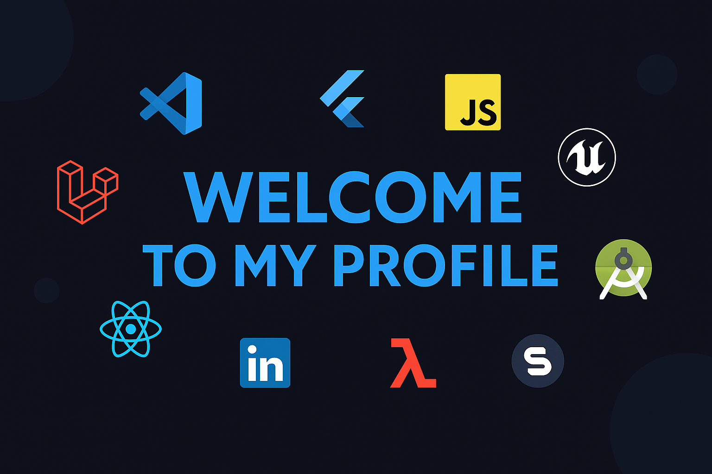
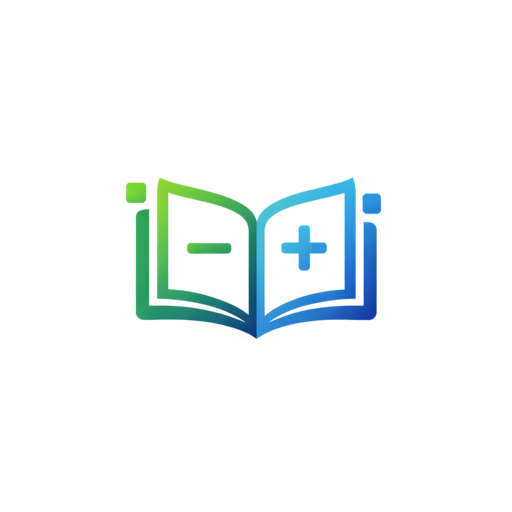
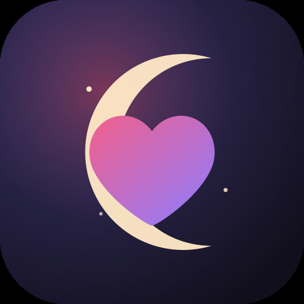

  

<h1 align="center">Mohamed Aziz Kaboudi</h1>

  

  
  
  

---

### About

Software engineer and founder. I build products end to end, from the first design frame to the store release, and increasingly I build the AI that runs inside them.

I graduated in Software Engineering from **ESPRIT** (Tunis) after a Bachelor's from **ISIG Kairouan**. I have shipped apps to the App Store and Google Play and placed 1st, 3rd and 4th across five hackathons. Most of it solo, most of it across the whole stack.

Arabic, French, English.

---

<h2 align="center">My Products</h2>

<table align="center">
<tr>
<td align="center" width="50%">
  
  <h3>Owemie</h3>
  
<strong>Live on iOS &amp; Android</strong>

  
Personal finance, done properly. Track money between people with reminders, proof photos, PDF statements and shared ledgers.

  

    
    
  

  

</td>
<td align="center" width="50%">
  
  <h3>Ömrüm</h3>
  
<strong>Live on iOS &amp; Android</strong>

  
A private app for two. No signup, just a pairing code. Live presence on the lock screen, shared drawing, calls.

  

    
    
  

  

</td>
</tr>
</table>

<em>Both designed, built, shipped and operated by me. Product, design, mobile, backend, infrastructure and the AI inside them.</em>

  <strong>© 2026 Mohamed Aziz Kaboudi. All rights reserved.</strong> 
  Owemie and Ömrüm are proprietary products. Their source code is private, and their names, logos, branding and design are protected. No part may be copied, reproduced, reused or redistributed without prior written permission.

---

### Stack

**Languages**

**Mobile**

**Frontend**

**Backend**

**Data**

**AI**

**Cloud & DevOps**

**Design & Tooling**

---

### Hackathons

| Result | Project | What it did |
|---|---|---|
| 🥇 1st place | Imaginary-ai | Story generation from image prompts |
| 🥉 3rd place | FinAssist | Personal finance analytics and automated reporting |
| 4th place | Cement Sales App | Field sales operations and vendor mapping |
| Participant | Gatra (with GIZ) | Water conservation platform with a voice assistant |
| Participant | Linguify.ai | AI language learning with a tutor chatbot |

---

### Certifications

- **NVIDIA** — Generative AI with Diffusion Models (2025)
- **NVIDIA** — Applications of AI for Predictive Maintenance (2025)
- **AWS Academy** — Cloud Foundations (2025)

---

### Get in touch

  

© 2026 Mohamed Aziz Kaboudi. All rights reserved.

